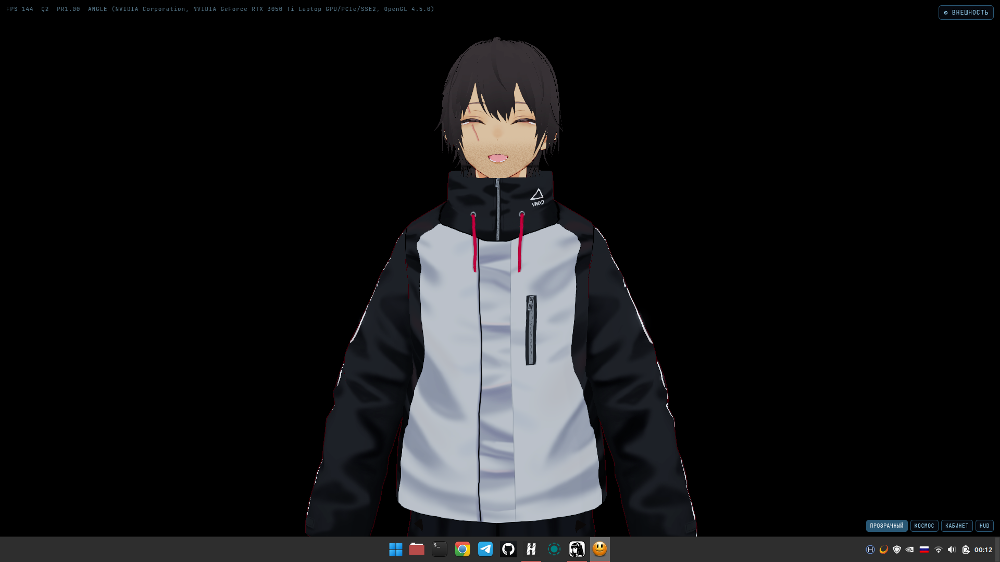
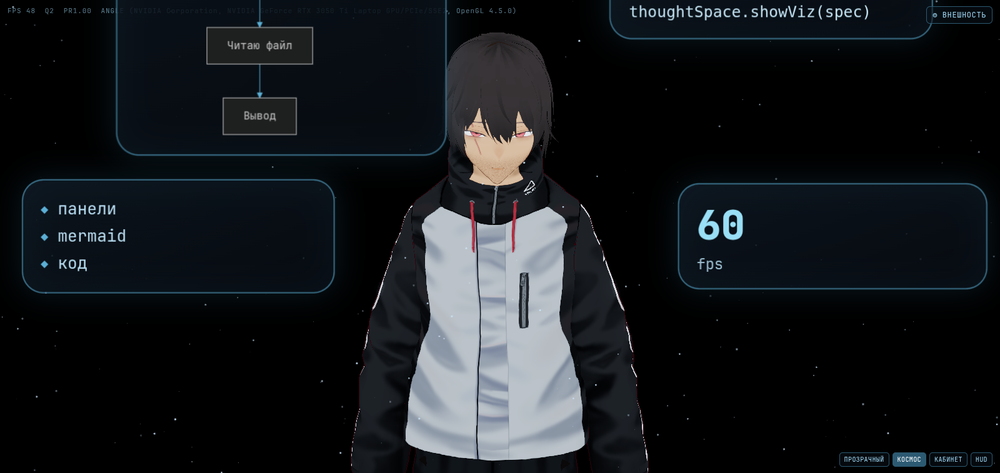
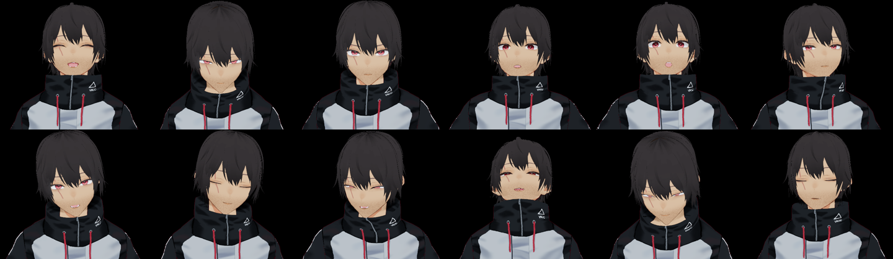
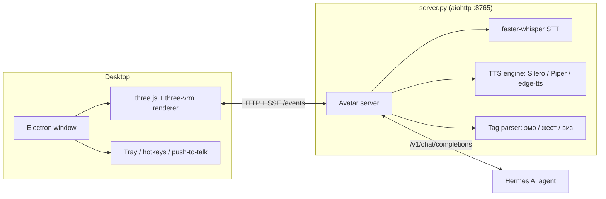

# Hermes Avatar

[](LICENSE)


A live, talking VRM avatar for your desktop — a visual front-end for the
[Hermes AI agent](https://github.com/NousResearch/hermes-agent). It listens
(STT), thinks (your Hermes instance), speaks (TTS with streaming + barge‑in),
shows emotion and gesture tags on its face/body, and projects a "thought
space" of floating panels (text, code, charts, mermaid diagrams, images)
around itself while it works.

Built for a single local GPU (tested on an RTX 3050 Ti, 4 GB VRAM) — 60 fps
render, sub‑second first‑audio latency, ≈2.1 GB VRAM total at idle.

[Русская версия README](README.ru.md)

## Demo

| Idle / speaking | Thought space (live tool-call graph) | 12 blendable emotions |
| --- | --- | --- |
|  |  |  |

More screenshots: [proofs/](proofs/) (per-stage acceptance evidence, logs, WER/latency reports).

## Features

- **Electron desktop window** — frameless, transparent, always-on-top; full /
  mini-widget / tray modes, global hotkey, push-to-talk.
- **VRM 1.0 rendering** via three.js + `@pixiv/three-vrm`: spring-bone hair
  physics, PBR materials, HDRI lighting, bloom/SSAO/ACES tonemap, adaptive
  quality to hold 60 fps.
- **ASCII "Matrix" look (default)** — fullscreen black screen with green
  digital rain; the avatar, Hermes in procedural bronze armor with a winged
  helmet, is drawn in glyphs by brightness (one GPU shader pass). An automatic
  "camera operator" cuts between angles (wide, 3/4, close-up, low) and moves
  closer when the avatar speaks. Keys: `A` toggles ASCII/3D, `C` toggles the
  camera, `E` opens the editor. `AVATAR_STYLE=pbr` restores the transparent
  3D look; URL params `?style=`, `?cell=9`, `?armor=0`, `?director=0`.
- **Appearance editor** — drag & drop any `.vrm`, tweak skin/hair/eye color,
  clothing, face-shape morphs, save/restore presets (`look.json`).
- **12 blendable emotions + gestures** driven by inline LLM tags
  (`[эмо:радость 0.7]`, `[жест:wave]`), phoneme-aligned lip-sync, blinking,
  saccades, idle breathing/nodding.
- **Thought space** — orbiting CSS3D panels around the avatar showing text,
  code, lists, charts, mermaid diagrams and images, plus a live particle
  graph of the agent's tool calls (think → search → read file → output).
  4 background modes: space / office / HUD / transparent desktop overlay.
- **Streaming voice** — sentence-level TTS streaming (first audio ≈0.2–1 s),
  pluggable engine (Silero / Piper / edge-tts / ElevenLabs), barge-in
  (user speech interrupts playback instantly).
- **Speech input** — faster-whisper (CUDA) STT, Silero VAD, noise/echo
  handling, measured WER ≈10% on a 10‑phrase calibration set with a stock
  laptop mic (recommend a USB headset for best results).
- **Ops** — systemd user unit + autostart, tray icon, "ghost mode" (avatar
  narrates agent actions on screen), voice/cron/Telegram event callouts.

## Architecture



## Requirements

- Linux (developed/tested on Mint/Ubuntu, X11)
- NVIDIA GPU with ≥ 4 GB VRAM (CUDA) for whisper + rendering; CPU fallback
  for STT exists but is slower
- Python 3.10+, Node.js 18+
- A running [Hermes](https://github.com/NousResearch/hermes-agent) instance
  (or any OpenAI-compatible chat endpoint) to talk to

## Quick start

```bash
git clone https://github.com/Nurulaev/hermes-avatar.git
cd hermes-avatar
python3 -m venv venv && ./venv/bin/pip install -r requirements.txt
npm install
cp .env.example .env   # fill in HERMES_URL / API_SERVER_KEY / voice settings
./scripts/download-voices.sh   # Piper voices (optional, only if TTS_ENGINE=piper)
./scripts/download-assets.sh   # extra sample VRM avatars (optional)
npm start               # or: ./run.sh for the Chromium kiosk variant
```

Open the window, drag a `.vrm` file onto it to swap the avatar, and start
talking (push-to-talk, default hotkey `Super+H` to toggle visibility).

## Configuration

All runtime settings are environment variables — see
[`.env.example`](.env.example) for the full list (server URL, port, voice
engine/voice, whisper model size, background effect, etc).

## Roadmap

- [ ] Wake-word detection ("Гермес") via openWakeWord
- [ ] Webcam-based gaze tracking (MediaPipe) as an alternative to cursor-follow
- [ ] NVIDIA Audio2Face-3D evaluation for full voice-driven facial animation
- [ ] Packaged releases (AppImage / .deb)

See [`proofs/ACCEPTANCE.md`](proofs/ACCEPTANCE.md) for the detailed,
stage-by-stage acceptance record this project was built against, and
[`proofs/acceptance/VERDICT.md`](proofs/acceptance/VERDICT.md) for the
final sign-off with measured numbers and known caveats (WER, wake-word,
ElevenLabs key, Telegram test).

## Credits

- [pixiv/three-vrm](https://github.com/pixiv/three-vrm) — VRM rendering
  library and the sample avatar used as the default model (MIT + VRM 1.0
  license, redistribution permitted — see
  [`proofs/stage1/LICENSE-hermes.vrm.txt`](proofs/stage1/LICENSE-hermes.vrm.txt)).
  Modified from the original sample.
- [rhasspy/piper-voices](https://huggingface.co/rhasspy/piper-voices) —
  Russian Piper TTS voices (downloaded on demand, not bundled).
- [Hermes AI](https://github.com/NousResearch/hermes-agent) by
  [Nous Research](https://nousresearch.com) — the agent this avatar is a
  face for.

## License

[MIT](LICENSE). Third-party assets (VRM samples, voice models) keep their
own licenses — see [Credits](#credits) and `scripts/download-*.sh`.
