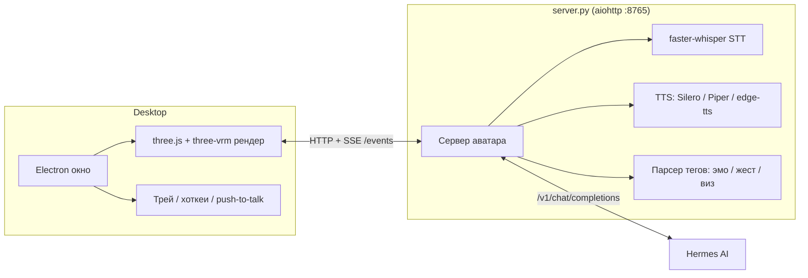

# Hermes Avatar

[](LICENSE)


Живой говорящий VRM-аватар для рабочего стола — визуальная оболочка для
[Hermes AI](https://github.com/NousResearch/hermes-agent). Слушает (STT),
думает (ваш инстанс Hermes), говорит (потоковый TTS с мгновенным barge-in),
показывает эмоции и жесты по тегам прямо в ответе LLM, а вокруг себя
разворачивает «пространство мыслей» — плавающие панели с текстом, кодом,
графиками, mermaid-схемами и картинками по ходу работы.

Рассчитан на один локальный GPU (проверено на RTX 3050 Ti, 4 ГБ VRAM):
60 fps рендера, первая фраза звучит меньше чем за секунду, ≈2.1 ГБ VRAM
в простое.

[English README](README.md)

## Демо

| Простой / говорит | Пространство мыслей (живой граф tool-calls) | 12 эмоций |
| --- | --- | --- |
|  |  |  |

Больше скриншотов и доказательств по этапам: [proofs/](proofs/).

## Возможности

- **Окно Electron** — без рамки, прозрачное, поверх всех окон; режимы
  полный / мини-виджет / трей, горячая клавиша, push-to-talk.
- **Рендер VRM 1.0** на three.js + `@pixiv/three-vrm`: физика волос
  (spring bones), PBR-материалы, HDRI-освещение, bloom/SSAO/ACES,
  адаптивное качество ради стабильных 60 fps.
- **Редактор внешности** — drag & drop любого `.vrm`, цвет кожи/волос/глаз,
  одежда, морфы лица, сохранение/восстановление пресетов (`look.json`).
- **12 смешиваемых эмоций и жесты** прямо из тегов LLM
  (`[эмо:радость 0.7]`, `[жест:wave]`), липсинк по визем-фонемам,
  моргание, саккады, дыхание и кивки в простое.
- **Пространство мыслей** — орбитальные CSS3D-панели вокруг аватара:
  текст, код, списки, графики, mermaid-схемы, картинки, плюс живой
  граф tool-calls агента (думаю → ищу → читаю файл → вывод) в виде частиц.
  4 режима фона: космос / кабинет / HUD / прозрачный поверх рабочего стола.
- **Потоковый голос** — TTS стримится по предложениям (первая фраза за
  ≈0.2–1 с), движок подключаемый (Silero / Piper / edge-tts / ElevenLabs),
  barge-in — перебили голосом, аватар мгновенно замолкает.
- **Распознавание речи** — faster-whisper (CUDA), Silero VAD, подавление
  шума/эха, замеренный WER ≈10% на встроенном микрофоне ноутбука
  (для лучшего качества — USB-гарнитура).
- **Эксплуатация** — systemd user unit с автозапуском, иконка в трее,
  «режим призрака» (аватар комментирует действия агента на экране),
  озвучка cron/Telegram-событий.

## Архитектура



## Требования

- Linux (разработано и проверено на Mint/Ubuntu, X11)
- NVIDIA GPU с ≥ 4 ГБ VRAM (CUDA) для whisper и рендера; есть CPU-фоллбэк
  для STT, но медленнее
- Python 3.10+, Node.js 18+
- Запущенный [Hermes](https://github.com/NousResearch/hermes-agent)
  (или любой OpenAI-совместимый чат-эндпоинт)

## Быстрый старт

```bash
git clone https://github.com/Nurulaev/hermes-avatar.git
cd hermes-avatar
python3 -m venv venv && ./venv/bin/pip install -r requirements.txt
npm install
cp .env.example .env   # заполнить HERMES_URL / API_SERVER_KEY / голос
./scripts/download-voices.sh   # голоса Piper (нужно только для TTS_ENGINE=piper)
./scripts/download-assets.sh   # дополнительные демо-модели VRM
npm start               # либо ./run.sh для варианта в Chromium-киоске
```

Откройте окно, перетащите `.vrm`-файл, чтобы сменить модель, и говорите
(push-to-talk, по умолчанию `Super+H` переключает видимость окна).

## Конфигурация

Все настройки — переменные окружения, полный список в
[`.env.example`](.env.example) (URL сервера, порт, движок/голос TTS,
размер модели whisper, фоновый эффект и т.д.).

## Roadmap

- [ ] Wake-word «Гермес» через openWakeWord
- [ ] Взгляд по веб-камере (MediaPipe) как альтернатива слежению за курсором
- [ ] Оценка NVIDIA Audio2Face-3D для мимики полностью из голоса
- [ ] Готовые сборки (AppImage / .deb)

Подробный, поэтапный протокол приёмки — в
[`proofs/ACCEPTANCE.md`](proofs/ACCEPTANCE.md), итоговый вердикт с цифрами
и оговорками (WER, wake-word, ключ ElevenLabs, Telegram-тест) — в
[`proofs/acceptance/VERDICT.md`](proofs/acceptance/VERDICT.md).

## Благодарности

- [pixiv/three-vrm](https://github.com/pixiv/three-vrm) — библиотека
  рендера VRM и демо-модель, взятая за основу аватара по умолчанию
  (лицензия MIT + VRM 1.0, распространение разрешено — см.
  [`proofs/stage1/LICENSE-hermes.vrm.txt`](proofs/stage1/LICENSE-hermes.vrm.txt)).
  Модель модифицирована из оригинального семпла.
- [rhasspy/piper-voices](https://huggingface.co/rhasspy/piper-voices) —
  русские голоса Piper TTS (скачиваются по требованию, не входят в репо).
- [Hermes AI](https://github.com/NousResearch/hermes-agent) от
  [Nous Research](https://nousresearch.com) — агент, для которого этот
  аватар служит лицом.

## Лицензия

[MIT](LICENSE). Сторонние ассеты (VRM-семплы, голосовые модели) сохраняют
собственные лицензии — см. раздел «Благодарности» и `scripts/download-*.sh`.
